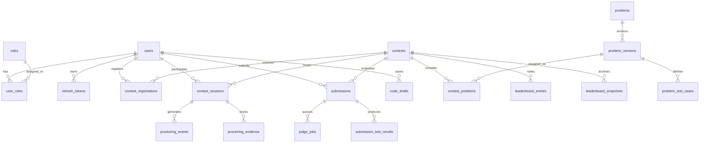

# Competitive Programming Platform — Database Schema & Data Architecture

| Property | Value |
|---|---|
| Document Version | 1.1 |
| Status | Implementation Baseline |
| Database Engine | PostgreSQL 16+ |
| Migration Tool | Alembic |
| Primary Key Standard | UUID v4 (`gen_random_uuid()`) |
| Timestamp Standard | UTC `TIMESTAMPTZ` |

---

## 1. Architectural Standards & Design Rules

1. **UUID Primary Keys**: Every table uses a UUID v4 primary key generated by PostgreSQL (`DEFAULT gen_random_uuid()`), preventing enumeration attacks and enabling distributed key generation.
2. **UTC Timestamps**: All temporal columns use `TIMESTAMPTZ` and default to `CURRENT_TIMESTAMP AT TIME ZONE 'UTC'`.
3. **Relational Integrity**: Foreign keys use explicit `ON DELETE RESTRICT` for financial, submission, and audit trails; cascading deletes (`ON DELETE CASCADE`) are restricted to ephemeral child records (e.g., test cases deleted during draft problem creation).
4. **Append-Only Auditing**: `audit_logs`, `proctoring_events`, and `submission_test_results` are immutable. Update and delete operations are rejected via trigger or application security.
5. **JSONB Usage**: Restricted to unstructured metadata, configuration blobs (`proctoring_config`, `allowed_languages`), and snapshot data. Core relational fields are strictly normalized.
6. **No Independent Contest Duration**: In accordance with the fixed-window timing model, `contests` does not store a standalone `duration` column. Contest duration is always derived: `end_time - start_time`.
7. **No FROZEN Contest Status**: Contest status remains `LIVE` during leaderboard freeze; freeze state is governed by `leaderboard_frozen`, `freeze_starts_at`, and `frozen_public_snapshot_id`.

---

## 2. Entity Relationship Diagram



---

## 3. Schema Definitions by Domain

### 3.1 Identity, Authentication & Roles

#### `users`
Represents platform accounts across all roles.
```sql
CREATE TABLE users (
    id UUID PRIMARY KEY DEFAULT gen_random_uuid(),
    username VARCHAR(50) NOT NULL,
    email VARCHAR(255) NOT NULL,
    password_hash TEXT NOT NULL,
    full_name VARCHAR(100) NOT NULL,
    avatar_url TEXT NULL,
    email_verified BOOLEAN NOT NULL DEFAULT FALSE,
    account_status VARCHAR(20) NOT NULL DEFAULT 'ACTIVE', -- ACTIVE, SUSPENDED, DEACTIVATED
    created_at TIMESTAMPTZ NOT NULL DEFAULT CURRENT_TIMESTAMP,
    updated_at TIMESTAMPTZ NOT NULL DEFAULT CURRENT_TIMESTAMP,
    CONSTRAINT uq_users_username UNIQUE (username),
    CONSTRAINT uq_users_email UNIQUE (email)
);
CREATE INDEX idx_users_email ON users(email);
CREATE INDEX idx_users_username ON users(username);
```

#### `roles` & `user_roles`
RBAC permission foundation. Roles: `SUPER_ADMIN`, `ADMIN`, `ORGANIZER`, `PROCTOR`, `PARTICIPANT`.
```sql
CREATE TABLE roles (
    id UUID PRIMARY KEY DEFAULT gen_random_uuid(),
    name VARCHAR(30) NOT NULL UNIQUE,
    description TEXT NOT NULL
);

CREATE TABLE user_roles (
    user_id UUID NOT NULL REFERENCES users(id) ON DELETE CASCADE,
    role_id UUID NOT NULL REFERENCES roles(id) ON DELETE RESTRICT,
    assigned_at TIMESTAMPTZ NOT NULL DEFAULT CURRENT_TIMESTAMP,
    PRIMARY KEY (user_id, role_id)
);
```

#### `refresh_tokens`
Stores hashed refresh tokens for session rotation and revocation.
```sql
CREATE TABLE refresh_tokens (
    id UUID PRIMARY KEY DEFAULT gen_random_uuid(),
    user_id UUID NOT NULL REFERENCES users(id) ON DELETE CASCADE,
    token_hash VARCHAR(64) NOT NULL, -- SHA-256 hash
    device_metadata JSONB NOT NULL DEFAULT '{}'::jsonb,
    expires_at TIMESTAMPTZ NOT NULL,
    revoked_at TIMESTAMPTZ NULL,
    created_at TIMESTAMPTZ NOT NULL DEFAULT CURRENT_TIMESTAMP,
    CONSTRAINT uq_refresh_tokens_hash UNIQUE (token_hash)
);
CREATE INDEX idx_refresh_tokens_user ON refresh_tokens(user_id);
```

#### `email_verification_tokens` & `password_reset_tokens`
```sql
CREATE TABLE email_verification_tokens (
    id UUID PRIMARY KEY DEFAULT gen_random_uuid(),
    user_id UUID NOT NULL REFERENCES users(id) ON DELETE CASCADE,
    token_hash VARCHAR(64) NOT NULL UNIQUE,
    expires_at TIMESTAMPTZ NOT NULL,
    consumed_at TIMESTAMPTZ NULL,
    created_at TIMESTAMPTZ NOT NULL DEFAULT CURRENT_TIMESTAMP
);

CREATE TABLE password_reset_tokens (
    id UUID PRIMARY KEY DEFAULT gen_random_uuid(),
    user_id UUID NOT NULL REFERENCES users(id) ON DELETE CASCADE,
    token_hash VARCHAR(64) NOT NULL UNIQUE,
    expires_at TIMESTAMPTZ NOT NULL,
    consumed_at TIMESTAMPTZ NULL,
    created_at TIMESTAMPTZ NOT NULL DEFAULT CURRENT_TIMESTAMP
);
```

#### `languages`
Supported programming languages mapped to Judge0 language IDs.
```sql
CREATE TABLE languages (
    id UUID PRIMARY KEY DEFAULT gen_random_uuid(),
    judge0_language_id INTEGER NOT NULL,
    name VARCHAR(50) NOT NULL,
    version VARCHAR(30) NOT NULL,
    extension VARCHAR(10) NOT NULL,
    enabled BOOLEAN NOT NULL DEFAULT TRUE,
    CONSTRAINT uq_languages_judge0_version UNIQUE (judge0_language_id, version)
);
```

---

### 3.2 Contest Management

#### `contests`
Authoritative contest configurations and timing boundaries.
```sql
CREATE TABLE contests (
    id UUID PRIMARY KEY DEFAULT gen_random_uuid(),
    slug VARCHAR(100) NOT NULL,
    title VARCHAR(200) NOT NULL,
    description TEXT NOT NULL,
    organizer_id UUID NOT NULL REFERENCES users(id) ON DELETE RESTRICT,
    start_time TIMESTAMPTZ NOT NULL,
    end_time TIMESTAMPTZ NOT NULL,
    registration_deadline TIMESTAMPTZ NOT NULL,
    status VARCHAR(20) NOT NULL DEFAULT 'DRAFT', -- DRAFT, SCHEDULED, LIVE, COMPLETED, CANCELLED
    visibility VARCHAR(20) NOT NULL DEFAULT 'PUBLIC', -- PUBLIC, PRIVATE
    max_participants INTEGER NOT NULL DEFAULT 500,
    scoring_type VARCHAR(20) NOT NULL DEFAULT 'ICPC',
    wrong_penalty_minutes INTEGER NOT NULL DEFAULT 20,
    freeze_starts_at TIMESTAMPTZ NULL,
    leaderboard_frozen BOOLEAN NOT NULL DEFAULT FALSE,
    frozen_public_snapshot_id UUID NULL,
    proctoring_config JSONB NOT NULL DEFAULT '{}'::jsonb,
    allowed_languages JSONB NOT NULL DEFAULT '[]'::jsonb,
    created_at TIMESTAMPTZ NOT NULL DEFAULT CURRENT_TIMESTAMP,
    updated_at TIMESTAMPTZ NOT NULL DEFAULT CURRENT_TIMESTAMP,
    CONSTRAINT uq_contests_slug UNIQUE (slug),
    CONSTRAINT chk_contest_times CHECK (start_time < end_time AND registration_deadline <= start_time)
);
CREATE INDEX idx_contests_status_start ON contests(status, start_time);
```

#### `contest_registrations`
Enforces capacity limits and unique participation.
```sql
CREATE TABLE contest_registrations (
    id UUID PRIMARY KEY DEFAULT gen_random_uuid(),
    contest_id UUID NOT NULL REFERENCES contests(id) ON DELETE CASCADE,
    user_id UUID NOT NULL REFERENCES users(id) ON DELETE RESTRICT,
    registration_status VARCHAR(20) NOT NULL DEFAULT 'CONFIRMED', -- CONFIRMED, CANCELLED
    registered_at TIMESTAMPTZ NOT NULL DEFAULT CURRENT_TIMESTAMP,
    CONSTRAINT uq_contest_registrations UNIQUE (contest_id, user_id)
);
CREATE INDEX idx_contest_reg_user ON contest_registrations(user_id);
```

#### `contest_sessions`
Active participant sessions during a live contest. Single-session rule enforced via unique constraint.
```sql
CREATE TABLE contest_sessions (
    id UUID PRIMARY KEY DEFAULT gen_random_uuid(),
    contest_id UUID NOT NULL REFERENCES contests(id) ON DELETE CASCADE,
    user_id UUID NOT NULL REFERENCES users(id) ON DELETE RESTRICT,
    started_at TIMESTAMPTZ NOT NULL DEFAULT CURRENT_TIMESTAMP,
    ended_at TIMESTAMPTZ NULL,
    last_heartbeat_at TIMESTAMPTZ NOT NULL DEFAULT CURRENT_TIMESTAMP,
    session_status VARCHAR(20) NOT NULL DEFAULT 'ACTIVE', -- ACTIVE, DISCONNECTED, TERMINATED
    proctoring_status VARCHAR(30) NOT NULL DEFAULT 'INITIALIZING', -- INITIALIZING, COMPLIANT, WARNING, DISQUALIFIED
    created_at TIMESTAMPTZ NOT NULL DEFAULT CURRENT_TIMESTAMP,
    CONSTRAINT uq_contest_sessions_user UNIQUE (contest_id, user_id)
);
CREATE INDEX idx_contest_sessions_heartbeat ON contest_sessions(session_status, last_heartbeat_at);
```

#### `contest_problems`
Connects an immutable problem version to a contest.
```sql
CREATE TABLE contest_problems (
    id UUID PRIMARY KEY DEFAULT gen_random_uuid(),
    contest_id UUID NOT NULL REFERENCES contests(id) ON DELETE CASCADE,
    problem_version_id UUID NOT NULL, -- references problem_versions(id)
    problem_label VARCHAR(10) NOT NULL, -- 'A', 'B', 'C', etc.
    display_order INTEGER NOT NULL,
    CONSTRAINT uq_contest_problems_label UNIQUE (contest_id, problem_label)
);
```

---

### 3.3 Problem Management & Versioning

#### `problems` & `problem_versions`
Problem statements and constraints are immutable once published.
```sql
CREATE TABLE problems (
    id UUID PRIMARY KEY DEFAULT gen_random_uuid(),
    problem_code VARCHAR(50) NOT NULL,
    owner_id UUID NOT NULL REFERENCES users(id) ON DELETE RESTRICT,
    created_at TIMESTAMPTZ NOT NULL DEFAULT CURRENT_TIMESTAMP,
    CONSTRAINT uq_problems_code UNIQUE (problem_code)
);

CREATE TABLE problem_versions (
    id UUID PRIMARY KEY DEFAULT gen_random_uuid(),
    problem_id UUID NOT NULL REFERENCES problems(id) ON DELETE CASCADE,
    version_number INTEGER NOT NULL,
    title VARCHAR(200) NOT NULL,
    statement TEXT NOT NULL,
    input_format TEXT NOT NULL,
    output_format TEXT NOT NULL,
    constraints TEXT NOT NULL,
    difficulty VARCHAR(20) NOT NULL DEFAULT 'MEDIUM',
    tags JSONB NOT NULL DEFAULT '[]'::jsonb,
    time_limit_ms INTEGER NOT NULL DEFAULT 1000,
    memory_limit_mb INTEGER NOT NULL DEFAULT 256,
    published_at TIMESTAMPTZ NULL,
    created_at TIMESTAMPTZ NOT NULL DEFAULT CURRENT_TIMESTAMP,
    CONSTRAINT uq_problem_versions UNIQUE (problem_id, version_number)
);
```

#### `problem_test_cases`
Hidden and sample test cases. Inputs and outputs may reference private S3 keys for large data.
```sql
CREATE TABLE problem_test_cases (
    id UUID PRIMARY KEY DEFAULT gen_random_uuid(),
    problem_version_id UUID NOT NULL REFERENCES problem_versions(id) ON DELETE CASCADE,
    input_reference TEXT NOT NULL, -- Inline text or s3://path
    expected_output_reference TEXT NOT NULL, -- Inline text or s3://path
    is_sample BOOLEAN NOT NULL DEFAULT FALSE,
    test_order INTEGER NOT NULL,
    CONSTRAINT uq_problem_test_cases_order UNIQUE (problem_version_id, test_order)
);
```

---

### 3.4 Submissions, Judging & Outbox

#### `submissions`
Primary record of participant code evaluation.
```sql
CREATE TABLE submissions (
    id UUID PRIMARY KEY DEFAULT gen_random_uuid(),
    contest_id UUID NOT NULL REFERENCES contests(id) ON DELETE RESTRICT,
    participant_id UUID NOT NULL REFERENCES users(id) ON DELETE RESTRICT,
    contest_session_id UUID NOT NULL REFERENCES contest_sessions(id) ON DELETE RESTRICT,
    contest_problem_id UUID NOT NULL REFERENCES contest_problems(id) ON DELETE RESTRICT,
    language_id UUID NOT NULL REFERENCES languages(id) ON DELETE RESTRICT,
    source_code TEXT NOT NULL,
    verdict VARCHAR(30) NOT NULL DEFAULT 'PENDING',
    submitted_at TIMESTAMPTZ NOT NULL DEFAULT CURRENT_TIMESTAMP,
    judged_at TIMESTAMPTZ NULL,
    score INTEGER NOT NULL DEFAULT 0,
    execution_time_ms INTEGER NULL,
    memory_used_kb BIGINT NULL,
    idempotency_key VARCHAR(64) NOT NULL,
    CONSTRAINT uq_submissions_idempotency UNIQUE (participant_id, idempotency_key)
);
CREATE INDEX idx_submissions_contest_participant ON submissions(contest_id, participant_id, submitted_at);
CREATE INDEX idx_submissions_contest_problem ON submissions(contest_id, contest_problem_id);
```

#### `judge_jobs`
Durable tracking for background judging workers.
```sql
CREATE TABLE judge_jobs (
    id UUID PRIMARY KEY DEFAULT gen_random_uuid(),
    submission_id UUID NOT NULL REFERENCES submissions(id) ON DELETE CASCADE,
    job_status VARCHAR(20) NOT NULL DEFAULT 'QUEUED', -- QUEUED, RUNNING, COMPLETED, FAILED
    priority INTEGER NOT NULL DEFAULT 10, -- Higher number = higher priority
    retry_count INTEGER NOT NULL DEFAULT 0,
    max_retries INTEGER NOT NULL DEFAULT 3,
    next_attempt_at TIMESTAMPTZ NULL,
    created_at TIMESTAMPTZ NOT NULL DEFAULT CURRENT_TIMESTAMP,
    started_at TIMESTAMPTZ NULL,
    completed_at TIMESTAMPTZ NULL,
    last_error TEXT NULL
);
CREATE INDEX idx_judge_jobs_status_priority ON judge_jobs(job_status, priority, created_at);
```

#### `submission_test_results`
Individual test case execution tracking with Judge0 tokens.
```sql
CREATE TABLE submission_test_results (
    id UUID PRIMARY KEY DEFAULT gen_random_uuid(),
    submission_id UUID NOT NULL REFERENCES submissions(id) ON DELETE CASCADE,
    test_case_id UUID NOT NULL REFERENCES problem_test_cases(id) ON DELETE RESTRICT,
    judge0_token VARCHAR(64) NULL,
    verdict VARCHAR(30) NOT NULL,
    execution_time_ms INTEGER NULL,
    memory_used_kb BIGINT NULL,
    output_reference TEXT NULL,
    created_at TIMESTAMPTZ NOT NULL DEFAULT CURRENT_TIMESTAMP
);
CREATE INDEX idx_test_results_submission ON submission_test_results(submission_id);
```

#### `transactional_outbox`
Atomic queue bridge ensuring zero lost events between PostgreSQL and Celery.
```sql
CREATE TABLE transactional_outbox (
    id UUID PRIMARY KEY DEFAULT gen_random_uuid(),
    event_type VARCHAR(100) NOT NULL,
    aggregate_id UUID NOT NULL,
    payload JSONB NOT NULL,
    status VARCHAR(20) NOT NULL DEFAULT 'PENDING', -- PENDING, DISPATCHED, FAILED
    created_at TIMESTAMPTZ NOT NULL DEFAULT CURRENT_TIMESTAMP,
    processed_at TIMESTAMPTZ NULL
);
CREATE INDEX idx_outbox_pending ON transactional_outbox(created_at) WHERE status = 'PENDING';
```

---

### 3.5 Drafts & Standings

#### `code_drafts`
Optimistic locking ensures simultaneous multi-tab editing does not clobber code.
```sql
CREATE TABLE code_drafts (
    id UUID PRIMARY KEY DEFAULT gen_random_uuid(),
    contest_id UUID NOT NULL REFERENCES contests(id) ON DELETE CASCADE,
    participant_id UUID NOT NULL REFERENCES users(id) ON DELETE CASCADE,
    problem_version_id UUID NOT NULL REFERENCES problem_versions(id) ON DELETE CASCADE,
    language_id UUID NOT NULL REFERENCES languages(id) ON DELETE RESTRICT,
    source_code TEXT NOT NULL,
    version BIGINT NOT NULL DEFAULT 1,
    updated_at TIMESTAMPTZ NOT NULL DEFAULT CURRENT_TIMESTAMP,
    CONSTRAINT uq_code_drafts UNIQUE (contest_id, participant_id, problem_version_id)
);
```

#### `participant_problem_results` & `leaderboard_entries`
ICPC score aggregation caches for rapid leaderboard rendering.
```sql
CREATE TABLE participant_problem_results (
    id UUID PRIMARY KEY DEFAULT gen_random_uuid(),
    contest_id UUID NOT NULL REFERENCES contests(id) ON DELETE CASCADE,
    participant_id UUID NOT NULL REFERENCES users(id) ON DELETE CASCADE,
    problem_id UUID NOT NULL, -- Problem version or logical problem
    solved BOOLEAN NOT NULL DEFAULT FALSE,
    accepted_submission_id UUID NULL REFERENCES submissions(id) ON DELETE RESTRICT,
    solved_at TIMESTAMPTZ NULL,
    wrong_attempts INTEGER NOT NULL DEFAULT 0,
    penalty_minutes INTEGER NOT NULL DEFAULT 0,
    CONSTRAINT uq_participant_problem UNIQUE (contest_id, participant_id, problem_id)
);

CREATE TABLE leaderboard_entries (
    id UUID PRIMARY KEY DEFAULT gen_random_uuid(),
    contest_id UUID NOT NULL REFERENCES contests(id) ON DELETE CASCADE,
    participant_id UUID NOT NULL REFERENCES users(id) ON DELETE CASCADE,
    problems_solved INTEGER NOT NULL DEFAULT 0,
    total_penalty INTEGER NOT NULL DEFAULT 0,
    last_accepted_at TIMESTAMPTZ NULL,
    rank INTEGER NOT NULL DEFAULT 0,
    updated_at TIMESTAMPTZ NOT NULL DEFAULT CURRENT_TIMESTAMP,
    CONSTRAINT uq_leaderboard_entries UNIQUE (contest_id, participant_id)
);
CREATE INDEX idx_leaderboard_rank ON leaderboard_entries(contest_id, rank);
```

#### `leaderboard_snapshots`
Permanent snapshot records for frozen public leaderboards and final certified results.
```sql
CREATE TABLE leaderboard_snapshots (
    id UUID PRIMARY KEY DEFAULT gen_random_uuid(),
    contest_id UUID NOT NULL REFERENCES contests(id) ON DELETE CASCADE,
    snapshot_type VARCHAR(30) NOT NULL, -- FROZEN_PUBLIC, FINAL_OFFICIAL
    snapshot_data JSONB NOT NULL,
    created_at TIMESTAMPTZ NOT NULL DEFAULT CURRENT_TIMESTAMP
);
```

---

### 3.6 Proctoring, Evidence & Appeals

#### `consents`
Explicit GDPR / DPDP consent tracking before contest entry.
```sql
CREATE TABLE consents (
    id UUID PRIMARY KEY DEFAULT gen_random_uuid(),
    user_id UUID NOT NULL REFERENCES users(id) ON DELETE RESTRICT,
    contest_id UUID NOT NULL REFERENCES contests(id) ON DELETE RESTRICT,
    consent_type VARCHAR(50) NOT NULL, -- BROWSER, WEBCAM, SCREEN
    policy_version VARCHAR(20) NOT NULL,
    granted BOOLEAN NOT NULL,
    granted_at TIMESTAMPTZ NOT NULL DEFAULT CURRENT_TIMESTAMP,
    withdrawn_at TIMESTAMPTZ NULL
);
```

#### `proctoring_events` & `proctoring_evidence`
```sql
CREATE TABLE proctoring_events (
    id UUID PRIMARY KEY DEFAULT gen_random_uuid(),
    contest_session_id UUID NOT NULL REFERENCES contest_sessions(id) ON DELETE CASCADE,
    participant_id UUID NOT NULL REFERENCES users(id) ON DELETE RESTRICT,
    event_type VARCHAR(50) NOT NULL, -- TAB_FOCUS_LOST, FULLSCREEN_EXIT, WEBCAM_MULTIPLE_FACES, etc.
    severity VARCHAR(20) NOT NULL, -- LOW, MEDIUM, HIGH
    event_timestamp TIMESTAMPTZ NOT NULL,
    metadata JSONB NOT NULL DEFAULT '{}'::jsonb,
    evidence_id UUID NULL,
    review_status VARCHAR(20) NOT NULL DEFAULT 'UNREVIEWED', -- UNREVIEWED, REVIEWED, DISMISSED
    created_at TIMESTAMPTZ NOT NULL DEFAULT CURRENT_TIMESTAMP
);
CREATE INDEX idx_proctoring_events_session ON proctoring_events(contest_session_id, event_timestamp);

CREATE TABLE proctoring_evidence (
    id UUID PRIMARY KEY DEFAULT gen_random_uuid(),
    contest_session_id UUID NOT NULL REFERENCES contest_sessions(id) ON DELETE CASCADE,
    storage_key TEXT NOT NULL,
    evidence_type VARCHAR(30) NOT NULL DEFAULT 'SCREENSHOT',
    captured_at TIMESTAMPTZ NOT NULL,
    expires_at TIMESTAMPTZ NOT NULL,
    access_level VARCHAR(20) NOT NULL DEFAULT 'PROCTOR_RESTRICTED',
    file_size INTEGER NOT NULL,
    created_at TIMESTAMPTZ NOT NULL DEFAULT CURRENT_TIMESTAMP
);
CREATE INDEX idx_proctoring_evidence_expiry ON proctoring_evidence(expires_at);
```

#### `warnings`, `disciplinary_actions` & `appeals`
```sql
CREATE TABLE warnings (
    id UUID PRIMARY KEY DEFAULT gen_random_uuid(),
    contest_id UUID NOT NULL REFERENCES contests(id) ON DELETE RESTRICT,
    participant_id UUID NOT NULL REFERENCES users(id) ON DELETE RESTRICT,
    issued_by UUID NOT NULL REFERENCES users(id) ON DELETE RESTRICT,
    reason TEXT NOT NULL,
    status VARCHAR(20) NOT NULL DEFAULT 'ACTIVE',
    created_at TIMESTAMPTZ NOT NULL DEFAULT CURRENT_TIMESTAMP
);

CREATE TABLE disciplinary_actions (
    id UUID PRIMARY KEY DEFAULT gen_random_uuid(),
    contest_id UUID NOT NULL REFERENCES contests(id) ON DELETE RESTRICT,
    participant_id UUID NOT NULL REFERENCES users(id) ON DELETE RESTRICT,
    action_type VARCHAR(30) NOT NULL, -- DISQUALIFIED, WARNING
    reason TEXT NOT NULL,
    evidence_reference UUID NULL,
    decided_by UUID NOT NULL REFERENCES users(id) ON DELETE RESTRICT,
    created_at TIMESTAMPTZ NOT NULL DEFAULT CURRENT_TIMESTAMP,
    overturned_at TIMESTAMPTZ NULL
);

CREATE TABLE appeals (
    id UUID PRIMARY KEY DEFAULT gen_random_uuid(),
    disciplinary_action_id UUID NOT NULL REFERENCES disciplinary_actions(id) ON DELETE RESTRICT,
    participant_id UUID NOT NULL REFERENCES users(id) ON DELETE RESTRICT,
    appeal_reason TEXT NOT NULL,
    status VARCHAR(20) NOT NULL DEFAULT 'PENDING', -- PENDING, ACCEPTED, REJECTED
    reviewed_by UUID NULL REFERENCES users(id) ON DELETE RESTRICT,
    reviewer_remarks TEXT NULL,
    submitted_at TIMESTAMPTZ NOT NULL DEFAULT CURRENT_TIMESTAMP,
    reviewed_at TIMESTAMPTZ NULL
);
CREATE INDEX idx_appeals_status ON appeals(status, submitted_at);
```

---

### 3.7 Communication & System Audit

#### `audit_logs`
Append-only system security and action logs.
```sql
CREATE TABLE audit_logs (
    id UUID PRIMARY KEY DEFAULT gen_random_uuid(),
    actor_id UUID NULL REFERENCES users(id) ON DELETE SET NULL,
    action VARCHAR(100) NOT NULL,
    resource_type VARCHAR(50) NOT NULL,
    resource_id UUID NULL,
    metadata JSONB NOT NULL DEFAULT '{}'::jsonb,
    ip_address INET NULL,
    created_at TIMESTAMPTZ NOT NULL DEFAULT CURRENT_TIMESTAMP
);
CREATE INDEX idx_audit_logs_resource ON audit_logs(resource_type, resource_id);
```
