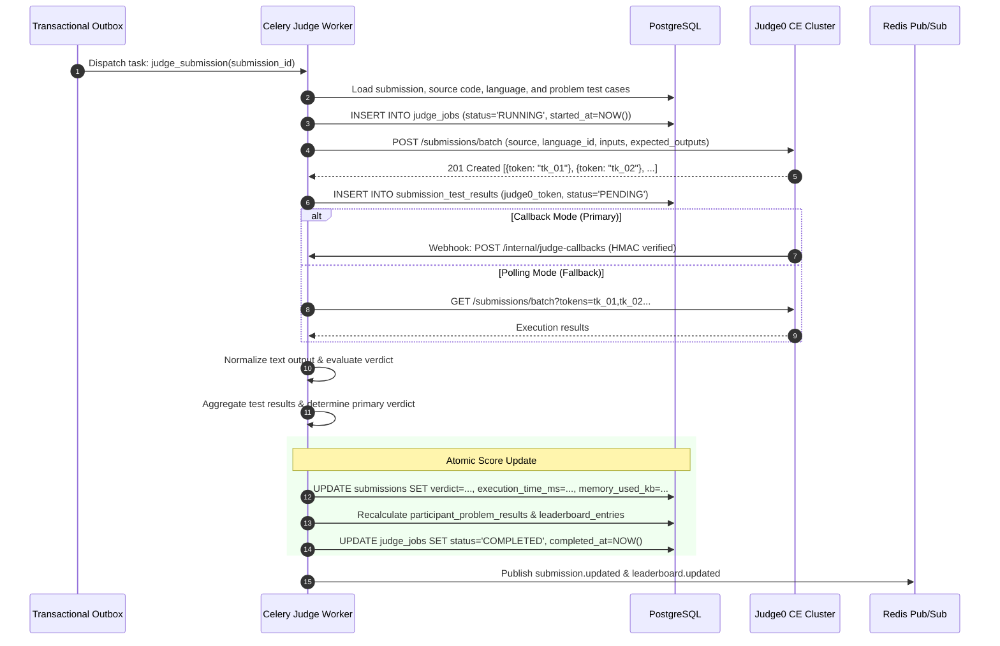

# Competitive Programming Platform — Judging Engine & Judge0 Integration

| Property | Value |
|---|---|
| Document Version | 1.1 |
| Status | Implementation Baseline |
| Target Scale | 25 executions/sec sustained, 50 executions/sec burst |
| Benchmark Workload | 6,000 test executions in ≤ 4 minutes |
| Default Judge Engine | Judge0 Community Edition (CE) |
| Scoring Model | ICPC Binary (All-or-Nothing) |

---

## 1. Overview & Core Principles

Code evaluation is the mission-critical core of the platform. The judging subsystem is designed around five non-negotiable guarantees:

1. **Isolation from FastAPI**: User code is NEVER compiled or executed inside application API processes.
2. **Provider Decoupling**: Application logic interacts solely through a provider-independent `JudgeProvider` abstraction; internal submissions are completely decoupled from Judge0-specific token schemes.
3. **Infrastructure Failures ≠ Wrong Answers**: A timeout in Judge0, a sandbox crash, or network failure between worker and judge yields `SYSTEM_ERROR`, never `WRONG_ANSWER`.
4. **Idempotent Result Ingestion**: Multiple deliveries of judge callbacks or overlapping polling runs never generate duplicate scoring records or multiple penalties.
5. **Durable Queuing**: Submissions durably accepted before the contest cutoff remain eligible for judging even if the external judge is temporarily paused or saturated.

---

## 2. Provider Adapter Architecture

To protect the platform from vendor lock-in and simplify testing with mocks, all judge interactions route through `JudgeProvider`:

```python
# app/services/judging/provider.py
from abc import ABC, abstractmethod
from typing import List, Dict, Any, Optional

class JudgeProvider(ABC):
    """Abstract interface for external code execution engines."""

    @abstractmethod
    async def get_languages(self) -> List[Dict[str, Any]]:
        """Fetch supported runtime languages and versions."""
        pass

    @abstractmethod
    async def create_batch(self, executions: List[Dict[str, Any]]) -> List[Dict[str, Any]]:
        """
        Submit a batch of test executions.
        Returns list of execution tokens/references.
        """
        pass

    @abstractmethod
    async def get_submission(self, token: str) -> Dict[str, Any]:
        """Poll the execution status and output for a given token."""
        pass

    @abstractmethod
    async def process_callback(self, payload: Dict[str, Any], signature: str) -> Dict[str, Any]:
        """Validate HMAC signature and parse incoming callback webhook."""
        pass
```

### Judge0 CE Concrete Implementation
The `Judge0Provider` implementation:
- Submits executions via `POST /submissions/batch?base64_encoded=true`.
- Sets `cpu_time_limit`, `memory_limit`, `wall_time_limit`, and compiler flags.
- Configures webhook callbacks to `POST /api/v1/internal/judge-callbacks` with an HMAC SHA-256 header.
- Implements bounded fallback polling for lost callbacks.

---

## 3. End-to-End Judging Workflow



---

## 4. Test Case Comparison & Output Normalization

Competitive programming problems often encounter whitespace discrepancies between operating systems (Windows `\r\n` vs Linux `\n`). The platform applies a strict, deterministic normalization comparator:

```python
# app/services/judging/comparator.py
def normalize_output(text: str) -> str:
    """
    Normalized text comparator rules:
    1. Normalize CRLF to LF.
    2. Strip trailing whitespace from every individual line.
    3. Strip trailing blank lines at the end of the text.
    4. Preserve leading and internal whitespace on non-blank lines.
    """
    if not text:
        return ""
    # Normalize line endings
    lines = text.replace("\r\n", "\n").replace("\r", "\n").split("\n")
    # Strip trailing whitespace on each line
    normalized_lines = [line.rstrip() for line in lines]
    # Remove trailing empty lines
    while normalized_lines and normalized_lines[-1] == "":
        normalized_lines.pop()
    return "\n".join(normalized_lines)

def compare_outputs(actual: str, expected: str) -> bool:
    return normalize_output(actual) == normalize_output(expected)
```

> [!IMPORTANT]
> The generic comparator does NOT perform fuzzy floating-point tolerance checks (e.g. `1e-6`). Problems requiring floating-point tolerance or multiple valid answers must be explicitly flagged as requiring custom checkers when supported.

---

## 5. Verdict Aggregation Rules

For ICPC binary scoring, a submission is either `ACCEPTED` or failed with the **first meaningful non-accepted verdict**.

### 5.1 Verdict Priority Matrix
When aggregating ordered test cases:
1. `SYSTEM_ERROR`: Takes absolute precedence. If any test case fails due to judge infrastructure unavailability, the overall submission status is marked `SYSTEM_ERROR` and scheduled for retry. It is **never** scored as `WRONG_ANSWER`.
2. `COMPILATION_ERROR`: If compilation fails, testing aborts immediately. `COMPILATION_ERROR` incurs **0 penalty minutes**.
3. **Execution Errors** (in order of test sequence):
   - `TIME_LIMIT_EXCEEDED` (TLE)
   - `MEMORY_LIMIT_EXCEEDED` (MLE)
   - `OUTPUT_LIMIT_EXCEEDED` (OLE)
   - `RUNTIME_ERROR` (RTE)
   - `WRONG_ANSWER` (WA)
4. `ACCEPTED`: Awarded only if **100% of test cases** pass comparison.

---

## 6. ICPC Scoring & Tie-Breaking Engine

### 6.1 Penalty Formula
For each solved problem:
$$\text{Problem Penalty} = \left\lfloor \frac{\text{accepted\_at} - \text{contest\_start\_time}}{60\text{ seconds}} \right\rfloor + (20 \times \text{incorrect\_attempts})$$

Total participant penalty:
$$\text{Total Penalty} = \sum_{\text{solved problems}} \text{Problem Penalty}$$

### 6.2 Qualifying Incorrect Attempts
- **Count towards penalty**: `WRONG_ANSWER`, `TIME_LIMIT_EXCEEDED`, `MEMORY_LIMIT_EXCEEDED`, `RUNTIME_ERROR`, `OUTPUT_LIMIT_EXCEEDED`.
- **Do NOT count towards penalty**: `COMPILATION_ERROR`, `SYSTEM_ERROR`, `PENDING`, `JUDGING`, `REJUDGING`, `INVALIDATED`.
- **Submissions after Acceptance**: Any submission made after a problem is already solved has zero impact on penalty or score.

### 6.3 Deterministic Tie-Breaking Order
When sorting the leaderboard:
1. **Problems Solved** (`DESC`): More problems solved ranks higher.
2. **Total Penalty** (`ASC`): Fewer penalty minutes ranks higher.
3. **Last Accepted Timestamp** (`ASC`): Earliest completion of the last solved problem ranks higher.
4. **Stable Final Tie-Breaker**: Ascending Participant ID (`ASC`).

---

## 7. Performance Benchmarks & Capacity Sizing

### 7.1 Target Benchmark Workload
- **Concurrent Participants**: 500
- **Submission Peak Burst**: 200 submissions submitted within 60 seconds
- **Average Hidden Tests**: 30 test cases per problem
- **Total Executions in Burst**: $200 \times 30 = 6,000$ test executions
- **Throughput Objective**: 
  - Sustained: ≥ 25 completed executions per second.
  - Burst: ≥ 50 completed executions per second.
  - Total Drain Time: ≤ 4 minutes.

### 7.2 Multi-Language Resource Characteristics
| Language | Compilation Cost | Startup Overhead | Strategy |
|---|---|---|---|
| **C++17 (GCC)** | High CPU once per submission | Very low runtime overhead | Batch all tests against compiled binary |
| **Python 3** | Zero compilation step | Low to medium interpreter overhead | Fast startup, strict time-limit multiplier |
| **Java 17 (OpenJDK)** | Heavy compilation + JVM warmup | High initial memory footprint | Adjust JVM heap flags (`-Xms64m -Xmx256m`) |

---

## 8. Controlled Rejudging Protocol

When an organizer corrects an erroneous problem test case or adjusts time limits:
1. Rejudging requires explicit authorization (`ORGANIZER` or `ADMIN`) and an audited reason.
2. The submission status transitions to `REJUDGING`.
3. The previous score results are archived into historical audit logs.
4. Test cases are re-evaluated against the authorized version.
5. Leaderboard standings and penalty minutes are transactionally recalculated from canonical scoring records.
