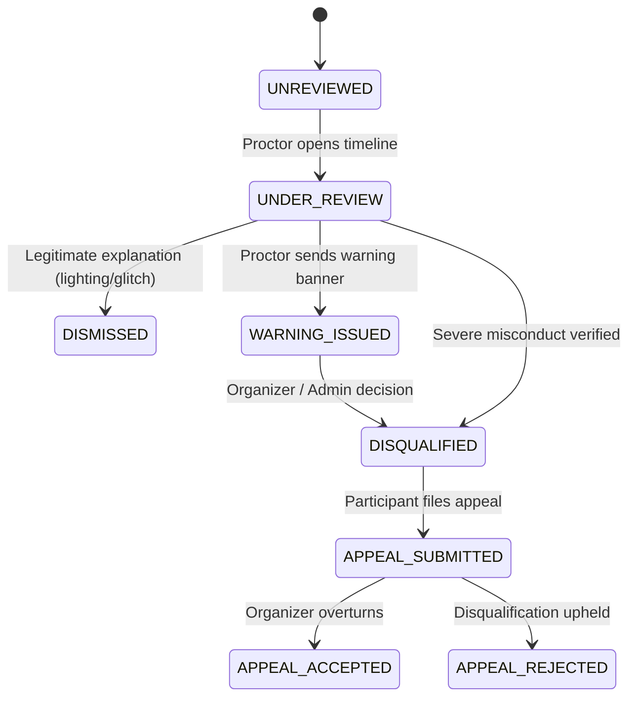

# Competitive Programming Platform — Hybrid Proctoring & Privacy Architecture

| Property | Value |
|---|---|
| Document Version | 1.1 |
| Status | Implementation Baseline |
| Target Scale | 500 concurrent sessions, ~60,000 screenshots / 2-hr contest |
| Proctoring Modes | 1. Browser only<br/>2. Browser + Webcam<br/>3. Browser + Webcam + Screen |
| Privacy Baseline | India DPDP Act 2023 & GDPR Compliant |

---

## 1. Design Philosophy & Ethical Guarantees

Hybrid proctoring on this platform enhances contest integrity while respecting participant dignity, privacy, and technical limitations. The platform adheres to six non-negotiable principles:

1. **No Continuous Raw Video Recording**: In V1, neither raw continuous webcam streams nor full-motion screen recordings are uploaded or stored. Only sampled client-side detection events and periodic downscaled screenshots are captured.
2. **Never Automatically Disqualify via AI**: Suspicion scores, face-absence flags, or tab-switch counters NEVER trigger automated disqualification. They serve solely as investigative indicators for human proctors.
3. **Copy/Paste Inside Editor is Normal**: Copying and pasting code within the Monaco editor is normal software engineering behavior. While events are logged for audit forensics, they carry zero suspicion score penalty.
4. **Client Events are Investigative, Not Proof**: Browser events are client-reported and technically forgeable. The backend treats them cautiously and relies on server-side heartbeats as authoritative connectivity signals.
5. **Private, Ephemeral Evidence**: Evidence is stored in non-public S3 buckets, accessible only via short-lived signed URLs, and governed by strict lifecycle deletion policies (7 days for screenshots).
6. **Mandatory Accommodations**: Participants with documented accessibility constraints or unsupported hardware can request accommodations without silent algorithmic penalties.

---

## 2. Proctoring Modes & Architecture

```mermaid
flowchart TB
    subgraph CLIENT [Participant Browser Workspace]
        BROWSER_MON[Browser Activity Monitor]
        WEBCAM_DET[Client-Side Face Detection]
        SCREEN_CAP[Periodic Screen Downsampler]
    end

    subgraph API [FastAPI Backend]
        CONSENT_SVC[Consent & Entry Gateway]
        EVENT_INGEST[Proctoring Event Ingestion]
        SCORE_ENGINE[Suspicion Scoring Engine]
        PRESIGN_SVC[S3 Presigned URL Service]
    end

    subgraph DATA [Storage & Queues]
        PG[(PostgreSQL DB)]
        S3[(Private Object Storage)]
        REDIS[(Redis Pub/Sub)]
    end

    subgraph CONSOLE [Proctor / Organizer Console]
        TIMELINE[Live Event Timeline]
        VIEWER[Signed Evidence Viewer]
        ACTIONS[Warning & Disciplinary Actions]
    end

    CLIENT -->|1. Consent & Status| CONSENT_SVC
    BROWSER_MON -->|2. Batched Events| EVENT_INGEST
    WEBCAM_DET -->|2. Detection Metadata| EVENT_INGEST
    SCREEN_CAP -->|3. Request Presigned URL| PRESIGN_SVC
    SCREEN_CAP -->|4. Direct Upload (JPEG <100KB)| S3

    EVENT_INGEST --> SCORE_ENGINE
    SCORE_ENGINE --> PG
    SCORE_ENGINE -->|Alerts| REDIS

    REDIS --> TIMELINE
    CONSOLE --> VIEWER
    VIEWER -->|Short-Lived Signed URL| S3
    ACTIONS --> PG
```

---

## 3. Client-Side Monitoring Subsystems

### 3.1 Browser Activity Monitoring
Captures environmental focus transitions during contest execution:
- **Events Tracked**:
  - `visibilitychange`: Document hidden / visible.
  - `window.blur` / `window.focus`: Focus lost or regained.
  - `fullscreenchange`: Exiting or entering full-screen workspace.
  - `contextmenu`: Context menu invocation attempts.
  - `copy` / `paste`: Code transfer actions (monitored for scope: internal vs external clipboard).
- **Anti-Spam & Cooldown**:
  - Repeated rapid focus events apply a **30-second cooldown** to prevent score inflation from rapid alt-tabbing.
  - Heartbeat signals are transmitted every 15–30 seconds. If heartbeats stop for >60 seconds, the backend marks the session `DISCONNECTED`.

### 3.2 Webcam-Based Presence Monitoring
- **Client-Side Frame Sampling**:
  - Webcams are sampled at low frequency (1 frame every 3–5 seconds) using client-side WebAssembly face detection (e.g., MediaPipe Face Detection).
  - Processing occurs **entirely in local browser memory**.
- **Detection Events Emitted**:
  - `WEBCAM_FACE_PRESENT`: Normal state.
  - `WEBCAM_MULTIPLE_FACES`: Two or more distinct faces detected in frame.
  - `WEBCAM_FACE_ABSENT`: No face detected continuously for >15 seconds.
- **Accuracy Safeguards**:
  - Lighting variations, webcam quality, and glasses can cause false absences. The system requires sustained multi-frame confirmation before emitting an absence event.

### 3.3 Screen Monitoring & Periodic Capture
- **Display Surface Selection**:
  - Leverages browser `getDisplayMedia` API.
  - Where browser metadata permits, captures surface type (`monitor`, `window`, or `browser`). Full-monitor sharing is enforced on supported browsers (Chrome/Edge).
- **Capture Specifications**:
  - **Interval**: Exactly once every 60 seconds.
  - **Resolution Downscaling**: Rendered onto an off-screen HTML5 canvas resized to a maximum of **640 × 360 pixels**.
  - **Compression**: High-compression JPEG (quality 0.6–0.7), guaranteeing file sizes under **100 KB**.
  - **Interruption Detection**: Listens to `MediaStreamTrack.onended`. If screen sharing is terminated by the user, a `SCREEN_SHARE_STOPPED` event is dispatched immediately.

---

## 4. Evidence Sizing & Storage Budget

For a standard 2-hour contest with 500 concurrent participants:

$$\text{Screenshots per user} = \frac{120\text{ minutes} \times 60\text{ seconds}}{60\text{ seconds interval}} = 120\text{ screenshots}$$

$$\text{Total Contest Screenshots} = 500\text{ participants} \times 120 = 60,000\text{ screenshots}$$

$$\text{Upper-Bound Storage} = 60,000 \times 100\text{ KB} \approx 6.0\text{ GB per contest}$$

### Storage Implementation:
- Screenshots are uploaded directly from client to private S3 via presigned PUT URLs, bypassing the FastAPI application tier.
- S3 bucket policies block all public access.
- Access is granted exclusively through short-lived (15-minute) presigned GET URLs generated by authorized proctor requests.

---

## 5. Server-Side Suspicion Scoring Engine

The scoring engine calculates an investigative suspicion score (0 to 100) per session:

### 5.1 Event Weights
| Event Code | Description | Severity | Base Weight | Cooldown Rule |
|---|---|---|---:|---|
| `TAB_FOCUS_LOST` | Window blurred or tab hidden | LOW | 5 | 30s per-session cooldown |
| `FULLSCREEN_EXIT` | Participant exited full-screen workspace | MEDIUM | 5 | 30s per-session cooldown |
| `WEBCAM_MULTIPLE_FACES` | Multiple faces detected in frame | HIGH | 20 | 60s per-session cooldown |
| `WEBCAM_FACE_ABSENT` | Prolonged absence (>30 seconds) | MEDIUM | 15 | 60s per-session cooldown |
| `SCREEN_SHARE_STOPPED` | Participant halted screen-sharing stream | HIGH | 10 | Immediate; sets session WARNING |
| `COPY_PASTE_INTERNAL` | Copy or paste within editor | INFO | 0 | No score increase |

### 5.2 Scoring Rules
$$\text{Suspicion Score} = \min\left(100, \sum_{\text{events}} \text{event.weight}\right)$$
- If the calculated score reaches 50+, the session is flagged as `NEEDS_REVIEW` on the proctor dashboard.
- If the calculated score reaches 80+, a real-time `proctoring.alert` is pushed to assigned proctors over WebSockets.

---

## 6. Proctor Review, Disciplinary Actions & Appeals



### Authorization Boundaries:
- **Proctors**: Can view assigned participants, examine evidence timelines, send in-app warning messages, add investigative notes, and recommend disciplinary action.
- **Organizers & Admins**: Hold the sole authority to execute final participant disqualification. Every disqualification requires a mandatory recorded justification and produces an immutable audit record.
- **Participants**: Receive immediate notification of disciplinary decisions and retain the right to submit an appeal with supporting context.

---

## 7. Data Privacy, Retention & Compliance

### 7.1 Retention Schedule
| Evidence Type | Retention Period | Deletion Mechanism |
|---|---|---|
| Screen Screenshots | 7 days post-contest | Automated S3 Lifecycle Expiration Rule |
| Browser Event Logs | 30 days post-contest | Celery maintenance cleanup task |
| Webcam Detection Events | 30 days post-contest | Celery maintenance cleanup task |
| Disciplinary & Appeal Records | 90 days (or until dispute resolution) | Archived in immutable audit log |

### 7.2 India DPDP Act & GDPR Alignment
- **Explicit Consent**: Transparent notice and granular consent checkboxes are presented before camera/screen permissions are requested.
- **Data Minimization**: High-resolution video is rejected in favor of low-res screenshots and lightweight event metadata.
- **Purpose Limitation**: Evidence is collected strictly for contest integrity and is deleted permanently upon retention expiration.
- **Accommodations Protocol**: Participants requiring accommodations (e.g. medical conditions, hardware limitations) can submit a request before registration closes. Approved requests exempt users from specific monitoring checks.
